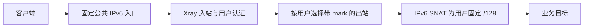

# 节点入口、出口与按用户 IPv6 策略总览

最后核对：**2026-11-16，Asia/Shanghai**。本文记录订阅入口、实际服务实例和出口策略，
并区分用户要求与当前配置。地址、端口、入站或出口策略变化时应同步更新本文。

## 地址角色与线路约定

| 地址角色 | 谁连接谁 | 是否按用户分配 |
| --- | --- | --- |
| 固定 IPv6 接入地址 | 客户端连接代理入口；XHTTP 上行和独立下行可以有不同入口 | 公共入口保持稳定，多个用户共用 |
| CDN 回源地址 | CDN 边缘连接源站 | 由源站和 CDN 配置决定，与代理用户的业务出口分开管理 |
| 普通直连源地址 | 代理连接业务目标时使用主机的共享 IPv4 / IPv6 | 当前普通直连不做用户独立分配 |
| 按用户固定 IPv6 出口 | 代理完成用户认证后，为业务连接选择用户所属的固定 IPv6 | 在已接管的入站内，按用户 ID 保存独立 /128 |

用户要求的线路约定是：**固定 IPv6 接入线路使用稳定的公共 IPv6 入口，业务 IPv6 出口
在认证后按用户固定分配；入口地址不能随用户分配或重置而变化。**
同一用户在同一出口策略实例内重连应复用原分配；不要求不同物理主机、不同策略实例
共用同一个出口地址。这里的用户独立出口指 IPv6，IPv4 目标或 IPv4 回退仍可共享主机 IPv4。



以上是按用户固定出口线路的语义示意，**实际已启用范围以本文现状表为准**。
固定入口、业务目标的 IPv6、用户出口 /128 是不同的地址角色。普通共享 IPv6 源地址
可以恰好与公共入口相同；按用户分配的 /128 不应作为稳定公共入口发布。

## 服务实例与物理主机

面板 node ID 标识一个受管理的 Xray 服务，不保证对应一台独立物理服务器。
管理地址 `172.21.0.1` 是面板侧控制通道地址，不能用于判断公网接入地址或服务器归属。

| node ID | 服务 | 对外服务器 | 实际服务实例 | 当前出口能力 |
| --- | --- | --- | --- | --- |
| 0 | Panel core | 面板本机 | 面板内核 | 当前未配置公网 IPv6 默认路由 |
| 1 | United States 01 - Direct | `54.215.234.191` | US01 的 Marzban-Node | 当前 IPv4；未启用固定 IPv6 出口实例 |
| 2 | Hong Kong 02 - Premium | `150.109.156.83` | HK02 的 Marzban-Node | 当前 IPv4；未启用固定 IPv6 出口实例 |
| 3 | United States 02 - Reality Vision | `23.246.155.106` / `2602:f35c:0:169::a` | `marzban-node-us02` | 原生双栈普通直连 |
| 4 | 美国 03 · HY2 独立节点 | 与 node 3 同一台服务器 | `marzban-node-us03-hy2` | 普通 HY2 与按用户 IPv6 专线并存 |
| 5 | 美国 03 · WG 至美国 01 | 与 node 3 同一台服务器 | `marzban-node-us03-wg-us01` | 经 WireGuard 从 US01 IPv4 出网 |

node 3、4、5 是同一台双栈服务器上的三个服务实例。其实际容器 `INBOUNDS` 分别为：

- node 3：`US02_DIRECT,US02_XHTTP,US02_RELAY_ENC`。
- node 4：`US03_HY2,US03_HY2_IPV6`。
- node 5：`US03_HY2_WG_US01`。

部分旧入站没有配置 `x-marzban-node-ids`，服务目录可能列出这些共享入站。判定实际承载
范围时，还要核对 Node 的 `INBOUNDS` 过滤、监听和代理配置，不能只看目录或订阅名称。

## 当前发布的基本线路

入口格式 `[IPv6]:端口` 仅用于本文显示；面板地址字段填写 IPv6 本身，端口单独填写。

| 线路 / 入站 | 当前发布的客户端入口 | 服务 | 当前业务出口 | 按用户固定 IPv6 |
| --- | --- | --- | --- | --- |
| 美国直连 01 / `DIRECT_US01` | `54.215.234.191:8443`，VLESS REALITY | node 1 | US01 IPv4 | 未启用 |
| 香港直连 02 / `HK02_DIRECT` | `150.109.156.83:9444`，VLESS REALITY | node 2 | HK02 IPv4 | 未启用 |
| 香港转美国 02 / `HK02_US` | `150.109.156.83:9443`，VLESS REALITY | node 2 | `US02_WG_OUT` 隧道路线；最终公网源地址需按该路线实测 | 未启用 |
| P1 IPv4 REALITY / `US02_DIRECT` | `23.246.155.106:443` | node 3 | `LOCAL_DIRECT_OUT`，普通双栈直连 | 未启用 |
| P1 IPv6 REALITY / `US02_DIRECT` | `[2602:f35c:0:169::a]:443`，固定 IPv6 接入 | node 3，与 P1 IPv4 共用入站 | `LOCAL_DIRECT_OUT`，普通双栈直连 | **未启用，见待对齐项** |
| 美国02加密专线 / `US02_RELAY_ENC` | `cascade_mode=replace`，客户端先连所配级联入口；`23.246.155.106:25443` 为落地目标 | node 3 | 未被固定 IPv6 控制器接管 | 未启用 |
| HY03 普通直连 / `US03_HY2` | `23.246.155.106:22443/udp` | node 4 | 普通双栈直连 | 未启用 |
| HY03 IPv6 优先 / `US03_HY2_IPV6` | `23.246.155.106:22444/udp` | node 4 | IPv6 优先，TCP 可回退 IPv4；IPv6 按用户 SNAT | **已启用** |
| HY03 → US01 / `US03_HY2_WG_US01` | `23.246.155.106:22445/udp` | node 5 | WireGuard → US01 IPv4 `54.215.234.191` | 未启用 |

HY03 两个直连入站的核心监听当前为 `0.0.0.0`，订阅发布 IPv4 地址；不能据“IPv6 优先”
名称把 `22444` 写成已经开放原生 IPv6 客户端接入。该名称描述业务出口策略。
HY03 三条线路的订阅 SNI 均为 `media.easyself.top`。
`HK_DIRECT` 当前没有发布主机项；加密专线另有一个已停用的“原始落地”主机项，
均不应当作现有可选直连订阅入口。级联语义见 [级联订阅](CASCADED-SUBSCRIPTIONS.zh-CN.md)。
加密专线当前启用级联替换，完整外部入口参数保留在面板；不能将落地主机地址直接当作
该订阅方案的客户端第一跳。

## XHTTP 上行、下行与固定 IPv6 接入

下表八个方案均归属 node 3 的 **`US02_XHTTP`**，核对时均为启用状态。
“上行 / 下行”指客户端与代理服务之间的 XHTTP 传输；它们不决定代理连接业务目标时
使用哪个用户出口。以下所有方案当前都未被按用户固定 IPv6 控制器接管。

| 方案 | 上行入口 | 独立下行入口 | IPv6 的具体含义 |
| --- | --- | --- | --- |
| P2 上下 REALITY 直连 | `23.246.155.106:443` | 沿用上行入口 | IPv4 接入 |
| P3 上 TLS-CDN / 下 REALITY | `media-upload-gateway.easyself.top:443` | `23.246.155.106:443` | CDN 上行，IPv4 直连下行 |
| P4 上 REALITY / 下 TLS-CDN | `23.246.155.106:443` | `media-assets-delivery.easyself.top:443` | IPv4 直连上行，CDN 下行 |
| P5 上下 TLS-CDN | `media-upload-gateway.easyself.top:443` | `media-assets-delivery.easyself.top:443` | 两个 CDN 入口域名，地址族需按实际连接判定 |
| P2 上下 IPv6 REALITY 直连 | `[2602:f35c:0:169::a]:443` | 沿用上行入口 | 上下行均为固定 IPv6 接入 |
| P3 上 TLS-CDN / 下 IPv6 REALITY | `media-upload-gateway.easyself.top:443` | `[2602:f35c:0:169::a]:443` | 独立下行使用固定 IPv6 |
| P4 上 IPv6 REALITY / 下 TLS-CDN | `[2602:f35c:0:169::a]:443` | `media-assets-delivery.easyself.top:443` | 上行使用固定 IPv6 |
| `[ipv6]` P5 上下 TLS-CDN EdgeOne IPv6回源 | `tvboxapi.easyus.top:443` | `tvboxapi.easyus.top:443` | 方案名描述 CDN 回源；不单凭名称确认客户端到边缘的地址族 |

P1 及上述 REALITY 连接的 SNI 当前为 `hlsliveali-cdn.ysp.cctv.cn`；TLS-CDN 连接的 SNI
使用其连接域名。TLS / REALITY 类型应以方案参数为准，不能只修改地址而丢弃原连接参数。

EdgeOne 项本次只核对了面板发布的方案参数，**未重新检查 EdgeOne 控制台或执行回源链路验收**。
CDN 的实际源站、回源地址族应结合控制台配置与源站连接另行确认。
客户端 → CDN、CDN → 源站、源站 → 业务目标，是三段不同的连接。

XHTTP 的 IPv6 上行或下行会影响订阅中的 IPv6 开关和方案归类；同名 `[ipv6]` 标记
不能证明已启用用户固定出口。导出与套餐选择规则见 [XHTTP 订阅](XHTTP-SUBSCRIPTIONS.zh-CN.md)。

## 按用户固定出口的已启用范围

2026-11-16 核对到的唯一实例为 `us03`：

| 配置项 | 当前值 / 作用 |
| --- | --- |
| 实例配置 | `/etc/marzban-egress/us03/node.json` |
| 管理入站 | 仅 `US03_HY2_IPV6` |
| 用户分配数据库 | `/etc/marzban-egress/us03/allocations.sqlite3` |
| 分配网段 | `2602:f35c:0:169::/64`，按用户持久保存独立 /128 |
| 地址归属 | 策略实例内的 Marzban 用户 ID，不按客户端 IP、订阅 token 或入口地址分配 |
| 路由选择 | 已认证用户 + 管理入站 → 对应的 `mz6-*` 出站与 socket mark |
| IPv6 NAT | `ip6 mz6_us03` 表按 mark 查询 `users` 映射并执行 SNAT |
| IPv4 行为 | 同样带用户 mark，但此规则只做 IPv6 SNAT，IPv4 目标仍用共享 IPv4 |
| 同步与回读 | `marzban-egress@us03.timer`；本次 `status` 返回 `enabled=true, verified=true` |

分配保存在数据库中，重连、刷新订阅和正常核心重启不应重新随机分配。
重置、迁移与恢复前应核对原地址映射。新用户尚未完成出口同步时先阻断，避免临时使用共享 IPv6。
维护、带预期地址校验的重置及一致性备份方法见 [HY03 IPv6 出口](NODE-IPV6-EGRESS.zh-CN.md)。
公网仓库不保存真实用户的分配清单、凭据、完整订阅 URL、私钥或完整运行配置；用户与
出口的实际映射以主机上的分配数据库和私有运维备份为准。

## 当前与用户要求尚未对齐的部分

固定 IPv6 接入的 P1、P2 IPv6、P3 IPv6 下行和 P4 IPv6 上行已经有订阅配置，
但它们仍属于 `US02_DIRECT` / `US02_XHTTP`，当前使用普通共享出口。
**不能把“固定 IPv6 接入，出口按用户分”的要求记录成这些线路已经全部完成。**
本次文档整理没有扩大固定出口策略的接管范围。

后续对齐时需先明确接管范围：

- P1 的 IPv4、IPv6 地址共用 `US02_DIRECT`；XHTTP 八个方案共用 `US02_XHTTP`。
  仅按这些入站 tag 启用用户出口，会同时覆盖同入站的 IPv4、IPv6 和 CDN 方案。
- 若只要求特定 IPv6 接入方案使用用户出口，需要先提供服务端可区分的入站或监听。
  只改订阅名称、地址、排序或套餐选择，不会建立新的服务端身份或独立出口策略。
- 验收应包含：固定入口不变、两名用户出口不同、同用户重连出口保持、IPv4 目标与回退
  行为正确，以及普通直连和 WireGuard 线路继续保持各自策略。

## 连接页面如何对应这些策略

“IPv4 → IPv6”等标记分别描述 Xray 识别的客户端入口地址族、当前主机拨号的远端地址族。
入口经过 CDN、反向代理或隧道时，Xray 看到的客户端地址还取决于原地址传递配置。
该标记不能单独证明是否启用了固定 NAT，也不是逐连接的 NAT 后公网源 IP 采集。

例如 `LOCAL_DIRECT_OUT` 使用共享 `2602:f35c:0:169::a` 可以产生 IPv4 → IPv6 记录；
`mz6-*` 用户出站在 SNAT 前也可能显示同一个本地源地址。是否按用户 SNAT，需要结合
入站 tag、出站 mark、分配数据库与 nftables 映射判断，并在需要时通过业务出口实测确认。
页面的“实际拨号目标”是业务远端 / 下一跳地址，不是目标网站看到的客户端公网源 IP。
采集实现与最近 500 条拨号记录的边界见 [连接信息说明](HOST-CONNECTIONS.zh-CN.md)。

## 以后如何复核和更新

本次核对读取了面板的 `GET /api/hosts`、`GET /api/core/config`、
`GET /api/core/xhttp-profiles`、`GET /api/node-services`，以及宿主的容器 `INBOUNDS`、
IPv6 地址 / 默认路由、固定出口实例配置、`status` 和 nftables SNAT 规则。
这些证据确认配置与接管范围；**本次未新增逐线路连通性、双用户最终公网出口或 CDN 回源验收**。

US02 / US03 宿主上的只读检查：

```sh
docker ps --format '{{.Names}}'
ip -6 address show dev enp3s0
ip -6 route show default
systemctl is-active marzban-egress@us03.timer
/usr/bin/python3 /usr/local/lib/marzban-egress/manage.py --config /etc/marzban-egress/us03/node.json status
nft list table ip6 mz6_us03
```

确认现有配置路径后再执行状态命令；不要用未知实例名建立新的空分配状态。
同步服务为 oneshot，定时器正常运行时服务本身可以处于 inactive，不能仅凭该状态判定失败。
公网 DNS 核对应在没有 fake-ip 接管的环境执行；客户端返回的 `198.18.0.0/15` 地址
不能记作真实入口、源站或用户公网出口。

新增或修改线路时，同步记录：发布名称与入站 tag、物理主机与服务实例、上行 / 下行入口、
CDN 回源、业务出口、用户分配实例和范围、IPv4 回退、验证日期与尚未验证的部分。
WireGuard 专线的源路由和故障阻断维护见 [HY03 经 US01 出口](HY03-WG-US01.zh-CN.md)。
